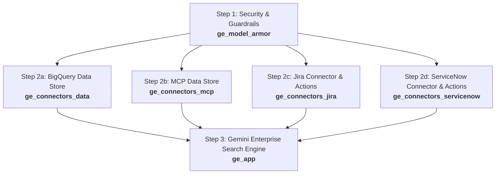

# Google Cloud Gemini Enterprise App Terraform Infrastructure

Comprehensive, modular Terraform configurations for provisioning and managing **Google Cloud Discovery Engine** (Gemini Enterprise) search applications, Data Stores, third-party data connectors (Jira, MCP, BigQuery), and **Model Armor** security guardrails.

---

## 📐 Architecture & Repository Overview

The infrastructure is organized into dedicated, modular directories to enable decoupled lifecycle management, independent deployments, and structured dependency ordering:

```
.
├── ge_model_armor/          # Step 1: Model Armor security guardrails & safety templates
├── ge_connectors_data/      # Step 2a: Discovery Engine Data Store for BigQuery (ecomm_events)
├── ge_connectors_mcp/       # Step 2b: Discovery Engine Data Store for MCP / Developer Docs
├── ge_connectors_jira/      # Step 2c: Third-party federated Jira Data Connector with BAP actions
├── ge_connectors_servicenow/ # Step 2d: Third-party ServiceNow Data Connector (Ingestion & Actions)
└── ge_app/                  # Step 3: Main Gemini Enterprise Search Engine Application
```

---

## 🚀 Recommended Deployment Sequence

To satisfy resource dependencies (e.g., Data Stores must exist before being attached to the Search Engine) and establish security policies early, execute the Terraform modules in the following order:



### Module Execution Rationale & Dependencies

| Order | Module Directory | Purpose & Dependency Rationale |
| :---: | :--- | :--- |
| **1** | [`ge_model_armor`](ge_model_armor/) | **Security & Guardrails Layer**: Provisions Model Armor templates, prompt injection/jailbreak detection, Responsible AI (RAI) safety filters, malicious URI checks, and SDP/PII inspection. Must be applied first to establish governance policies. |
| **2a** | [`ge_connectors_data`](ge_connectors_data/) (NOT READY) | **Data Layer (BigQuery)**: Provisions the Discovery Engine Data Store for BigQuery structured e-commerce data (`ecomm_events`). Must be created before attaching to the search app. |
| **2b** | [`ge_connectors_mcp`](ge_connectors_mcp/) (NOT READY) | **Data Layer (MCP Docs)**: Provisions the Discovery Engine Data Store for Model Context Protocol (MCP) developer documentation (`mcp_data`). Must be created before attaching to the search app. |
| **2c** | [`ge_connectors_jira`](ge_connectors_jira/) | **Integration Layer (Jira)**: Configures the federated Jira Data Connector with Business Application Platform (BAP) actions for issue management, comments, attachments, and status tracking. |
| **2d** | [`ge_connectors_servicenow`](ge_connectors_servicenow/) | **Integration Layer (ServiceNow)**: Configures the ServiceNow Data Connector (Data Ingestion & Actions) with BAP actions for incident creation and ticket lifecycle management. |
| **3** | [`ge_app`](ge_app/) | **Application Layer**: Provisions the Gemini Enterprise Search Engine app (`google_discovery_engine_search_engine`), links the Data Stores provisioned in Step 2, and enables enterprise platform features. |

---

## 📋 Prerequisites & Initial Setup

Before running any module, verify that the following prerequisites are met:

### 1. Tooling Requirements
- **Terraform CLI**: Version `>= 1.5.0`
- **Google Cloud SDK**: `gcloud` CLI installed and authenticated

### 2. Authentication & GCP Project Setup
Authenticate your local session with Google Cloud Application Default Credentials (ADC):
```bash
gcloud auth application-default login
```

Ensure your active GCP project has billing enabled and required APIs activated:
```bash
gcloud services enable \
  discoveryengine.googleapis.com \
  modelarmor.googleapis.com
```

### 3. Required IAM Roles
The executing identity requires the following minimum IAM roles on the GCP project:
- `roles/discoveryengine.admin` (Discovery Engine Admin)
- `roles/modelarmor.admin` (Model Armor Admin)

---

## 📂 Detailed Module Breakdown & Documentation

### 1. Model Armor Security Guardrails (`ge_model_armor`)
- **Directory Path**: [`ge_model_armor/`](ge_model_armor)
- **Primary Resource**: [`google_model_armor_template`](ge_model_armor/main.tf#L1) (using `google-beta` provider)
- **Key Files**:
  - [`main.tf`](ge_model_armor/main.tf) - Defines security filter configurations and enforcement settings.
  - [`variables.tf`](ge_model_armor/variables.tf) - Declarations for location, thresholds, and filter rules.
  - [`terraform.tfvars`](ge_model_armor/terraform.tfvars) - Default variable values for production guardrails.
  - [`providers.tf`](ge_model_armor/providers.tf) - Provider version declarations (`google-beta >= 7.3.0`).
- **Configured Features**:
  - **Prompt Injection & Jailbreak Detection**: Enforces detection for confidence level `MEDIUM_AND_ABOVE`.
  - **Malicious URI Filtering**: Enabled to detect harmful links in inputs/outputs.
  - **Responsible AI (RAI) Filters**: Active filtering for `HATE_SPEECH`, `HARASSMENT`, `SEXUALLY_EXPLICIT`, and `DANGEROUS` content (`MEDIUM_AND_ABOVE`).
  - **Sensitive Data Protection (SDP)**: Basic PII filter enforcement enabled.
  - **Template Metadata**: Set to `INSPECT_AND_BLOCK` mode with custom error code `400`, operation logging, and multi-language detection enabled.

---

### 2. BigQuery Data Store (`ge_connectors_data`)
- **Directory Path**: [`ge_connectors_data/`](ge_connectors_data)
- **Primary Resource**: [`google_discovery_engine_data_store.dc_bq`](ge_connectors_data/main.tf#L5)
- **Key Files**:
  - [`main.tf`](ge_connectors_data/main.tf) - Provisions BigQuery structured data store (`ecomm_events`).
  - [`variables.tf`](ge_connectors_data/variables.tf) - Data store variables, schema IDs, and layout parsing options.
  - [`terraform.tfvars`](ge_connectors_data/terraform.tfvars) - Data store configuration values.
  - [`providers.tf`](ge_connectors_data/providers.tf) - Provider version declarations (`google >= 6.49.2`, `google-beta >= 7.3.0`).
- **Configured Features**:
  - **Data Store ID**: `ecomm-events_1780862168950` (Display Name: `ecomm_events`)
  - **Industry Vertical**: `GENERIC`
  - **Solution Types**: `SOLUTION_TYPE_SEARCH`
  - **Layout Parsing**: Disabled by default for optimized BigQuery structured event indexing.

---

### 3. MCP Developer Docs Data Store (`ge_connectors_mcp`)
- **Directory Path**: [`ge_connectors_mcp/`](ge_connectors_mcp)
- **Primary Resource**: [`google_discovery_engine_data_store.dc_mcp`](ge_connectors_mcp/main.tf#L5)
- **Key Files**:
  - [`main.tf`](ge_connectors_mcp/main.tf) - Provisions Model Context Protocol (MCP) data store.
  - [`variables.tf`](ge_connectors_mcp/variables.tf) - Data store properties and schema bindings.
  - [`terraform.tfvars`](ge_connectors_mcp/terraform.tfvars) - MCP data store settings (`kroger_demo_ds_mcp` / `mcp_data`).
  - [`providers.tf`](ge_connectors_mcp/providers.tf) - Provider version declarations (`google >= 6.49.2`, `google-beta >= 7.3.0`).
- **Configured Features**:
  - **Data Store ID**: `developer-docs_1784867512211_mcp_data` / `kroger_demo_ds_mcp`
  - **Industry Vertical**: `GENERIC`
  - **Solution Types**: `SOLUTION_TYPE_SEARCH`
  - **Default Schema**: `default_schema`

---

### 4. Federated Jira Connector & BAP Actions (`ge_connectors_jira`)
- **Directory Path**: [`ge_connectors_jira/`](ge_connectors_jira)
- **Primary Resource**: [`google_discovery_engine_data_connector.jira-with-actions`](ge_connectors_jira/main.tf#L1)
- **Key Files**:
  - [`main.tf`](ge_connectors_jira/main.tf) - Configures Jira OAuth connector, destination endpoints, entities, and BAP actions.
  - [`variables.tf`](ge_connectors_jira/variables.tf) - Declarations for Jira authentication, entity indexing, and BAP connection parameters.
  - [`terraform.tfvars`](ge_connectors_jira/terraform.tfvars) - Credentials template and action configuration.
  - [`providers.tf`](ge_connectors_jira/providers.tf) - Provider version declarations (`google >= 6.49.2`, `google-beta >= 7.3.0`).
- **Configured Features**:
  - **Connector Type**: `THIRD_PARTY_FEDERATED` (Data Source: `jira`, Version `3`)
  - **Auth Mode**: `OAUTH` with OAuth Client ID / Secret and periodic sync (`86400s`).
  - **Modes**: `FEDERATED` and `ACTIONS` enabled.
  - **Business Application Platform (BAP) Actions**:
    - `create_issue`, `update_issue`, `change_issue_status`, `create_comment`, `update_comment`, `upload_attachment`
  - **Indexed Entities**: `project`, `attachment`, `comment`, `issue`, `bug`, `epic`, `story`, `task`, `worklog`, `board`.

---

### 5. ServiceNow Data Connector & Actions (`ge_connectors_servicenow`)
- **Directory Path**: [`ge_connectors_servicenow/`](ge_connectors_servicenow)
- **Primary Resource**: [`google_discovery_engine_data_connector.servicenow-with-actions`](ge_connectors_servicenow/main.tf#L6)
- **Documentation**:
  - [Google Cloud: Set up a ServiceNow data store](https://docs.cloud.google.com/gemini/enterprise/docs/connectors/servicenow/set-up-data-store)
  - [Google Cloud: ServiceNow third-party configuration](https://docs.cloud.google.com/gemini/enterprise/docs/connectors/servicenow/third-party-config)
  - [Google Cloud: ServiceNow supported actions](https://docs.cloud.google.com/gemini/enterprise/docs/connectors/servicenow#supported-actions)
- **Key Files**:
  - [`main.tf`](ge_connectors_servicenow/main.tf) - Configures the ServiceNow OAuth/ROPC connector, dynamic entities with optional inclusion filters, BAP action bindings, destination endpoints, and lifecycle rules.
  - [`variables.tf`](ge_connectors_servicenow/variables.tf) - Declarations for ServiceNow credentials, endpoints, sync schedules, rate limits, entities, and actions.
  - [`outputs.tf`](ge_connectors_servicenow/outputs.tf) - Exports connector ID, resource name, state, and auto-provisioned entity Data Store IDs.
  - [`terraform.tfvars`](ge_connectors_servicenow/terraform.tfvars) - Variable values and credentials template with copy-paste blocks for both Federated Search and Data Ingestion modes.
  - [`providers.tf`](ge_connectors_servicenow/providers.tf) - Provider version declarations (`google >= 6.49.2`, `google-beta >= 7.3.0`).

#### Supported Connection Modes

ServiceNow supports two distinct operational modes. Choose the mode that fits your architectural requirements:

| Feature / Requirement | Option A: Federated Search & Actions | Option B: Data Ingestion & Actions |
| :--- | :--- | :--- |
| **`connector_modes`** | `["FEDERATED", "ACTIONS"]` | `["DATA_INGESTION", "ACTIONS"]` |
| **Primary Use Case** | Real-time live queries directly against ServiceNow; zero data replication. Matches `ge_connectors_jira` architecture. | Synchronizes, crawls, and indexes ServiceNow records into a local Discovery Engine data store for high-performance semantic search. |
| **Auth Grant Type** | `OAUTH` (OAuth Authorization Code grant) | `OAUTH_PASSWORD_GRANT` (Resource Owner Password Credentials / ROPC) |
| **Required Credentials** | Client ID & Client Secret | Client ID, Client Secret, Ingestion User Account, & User Password |
| **Action Execution** | Enabled via OAuth Authorization Code flow | Enabled via secondary OAuth Authorization Code flow |
| **Data Freshness** | Immediate / Real-time | Periodic sync (`refresh_interval`, default `86400s`; `incremental_refresh_interval`, default `21600s`) |

#### Parameter Reference & Coverage

| Category | Parameter | Type | Default | Description |
| :--- | :--- | :--- | :--- | :--- |
| **Core** | `servicenow_instance_uri` | `string` | *(Required)* | Base instance URL (e.g., `https://your-instance.service-now.com`). |
| | `servicenow_client_id` | `string` | *(Required)* | OAuth Client ID from ServiceNow Application Registry. |
| | `servicenow_client_secret` | `string` | *(Required)* | OAuth Client Secret (must be alphanumeric per ServiceNow guidelines). |
| | `servicenow_auth_type` | `string` | `"OAUTH_PASSWORD_GRANT"` | Authentication grant type (`OAUTH_PASSWORD_GRANT` for Ingestion, `OAUTH` for Federated). |
| | `servicenow_user_account` | `string` | `""` | Username / email for ingestion user (required for `DATA_INGESTION`). |
| | `servicenow_password` | `string` | `""` | User password for ingestion user (required for `DATA_INGESTION`). |
| **Endpoints** | `servicenow_destination_host` | `string` | *(Required)* | Host destination URL (`https://your-instance.service-now.com`). |
| | `servicenow_action_auth_uri` | `string` | `"{uri}/oauth_auth.do"` | Authorization endpoint URL. Automatically derived from `servicenow_instance_uri`. |
| | `servicenow_action_token_uri`| `string` | `"{uri}/oauth_token.do"`| Token endpoint URL. Automatically derived from `servicenow_instance_uri`. |
| **Advanced** | `servicenow_max_qps` | `string` | `""` | Maximum queries per second rate limit sent to ServiceNow (empty = unthrottled, typical = `"100"`). |
| | `servicenow_url_suffix` | `string` | `""` | Portal link suffix (e.g. `"sp"` for Service Portal). Empty uses native desktop UI links. |
| | `servicenow_sync_since` | `string` | `""` | Optional ISO date cutoff (`YYYY-MM-DD`) to sync incidents created on or after this date. |
| | `servicenow_static_ip_enabled`| `bool` | `false` | Enable dedicated static egress IP addresses for firewall allowlists. |
| | `servicenow_action_include_system_tables` | `bool` | `false` | Controls whether ServiceNow system tables (`sys_*`) are exposed. Default `false`. |
| **Sync** | `servicenow_refresh_interval` | `string` | `"86400s"` | Full sync schedule interval (24 hours). Minimum `1800s` (30m), maximum 7 days. |
| | `servicenow_incremental_refresh_interval` | `string` | `"21600s"` | Incremental sync schedule interval (6 hours). |
| **Entities** | `servicenow_entities` | `list(string)` | `["incident", ...]` | Default entities: `incident`, `knowledge_base`, `catalog`, `knowledge`, `users`, `attachment`. |
| | `servicenow_entity_configs` | `list(object)` | `[]` | Advanced entity definitions with `inclusion_filters` (e.g. `knowledgeBaseSysId`, `catalogSysId`). |
| **Actions** | `servicenow_bap_enabled_actions` | `list(string)` | `["create_incident", "update_incident"]` | Enabled BAP actions (incident creation/updating, change requests, catalog requests). |
| **Security** | `kms_key_name` | `string` | `""` | Optional Cloud KMS encryption key resource name for CMEK compliance. |

#### Prerequisites & ServiceNow Configuration

1. **OAuth Application Registry**:
   - In ServiceNow, navigate to **All > System OAuth > Application Registry > New**.
   - For **Federated Search / Actions**: Select **Inbound integration experience > New integration** with Grant type **OAuth authorization code**. Set Redirect URL to:
     ```
     https://vertexaisearch.cloud.google.com/oauth-redirect,https://vertexaisearch.cloud.google.com/console/oauth/default_oauth.html
     ```
   - For **Data Ingestion**: Select **OAuth resource owner password credential grant type** (ROPC).
   - Ensure the **Allow access only to APIs in selected scope** checkbox is unchecked (leaving scope empty ensures the integration is broadly scoped).
2. **User Roles & Table API Access**:
   - The integration identity requires access to the Table API (`snc_internal` or custom REST role).
   - Accessible tables: `incident`, `sc_catalog`, `sc_cat_item`, `kb_knowledge`, `sys_attachment`, `sys_user`.
   - To configure and manage ACL rules or elevate roles, administrative permissions (`security_admin` or `admin`) are required.
3. **Table Indexing**:
   - Verify that table indexing is enabled on your ServiceNow instance for search optimization.

---

### 6. Gemini Enterprise Search Application (`ge_app`)
- **Directory Path**: [`ge_app/`](ge_app)
- **Primary Resource**: [`google_discovery_engine_search_engine.kr_ge_app_tf`](ge_app/main.tf#L5)
- **Key Files**:
  - [`main.tf`](ge_app/main.tf) - Defines search app parameters, attached data store IDs, subscription tier, and feature flags.
  - [`variables.tf`](ge_app/variables.tf) - Search engine configurations, enterprise feature flag schema, and knowledge graph settings.
  - [`outputs.tf`](ge_app/outputs.tf) - Outputs search engine ID and resource name.
  - [`terraform.tfvars`](ge_app/terraform.tfvars) - Target engine settings and feature state toggles.
  - [`providers.tf`](ge_app/providers.tf) - Provider version declarations (`google >= 6.49.2`, `google-beta >= 7.3.0`).
- **Configured Features**:
  - **App Type**: `APP_TYPE_INTRANET`
  - **Subscription Tier**: `SUBSCRIPTION_TIER_SEARCH_AND_ASSISTANT` with `SEARCH_ADD_ON_LLM` and `SEARCH_TIER_ENTERPRISE`.
  - **Attached Data Stores**: Links Data Stores created in Step 2 (`ecomm-events_1780862168950`, `developer-docs_1784867512211_mcp_data`).
  - **Active Enterprise Features**:
    - `agent-gallery` (`FEATURE_STATE_ON`)
    - `model-selector` (`FEATURE_STATE_ON`)
    - `no-code-agent-builder` (`FEATURE_STATE_ON`)
    - `notebook-lm` (`FEATURE_STATE_ON`)
    - `people-search-org-chart` (`FEATURE_STATE_ON`)
    - `personalization-memory` (`FEATURE_STATE_ON`)
    - `personalization-suggested-highlights` (`FEATURE_STATE_ON`)
    - `prompt-gallery` (`FEATURE_STATE_ON`)

---

## 🛠️ Step-by-Step Execution Guide

Run the modules in the exact sequence outlined below. Before applying, update the `terraform.tfvars` in each folder with your specific GCP project parameters and credentials.

### Step 1: Deploy Model Armor Guardrails
```bash
cd ge_model_armor
terraform init
terraform plan
terraform apply
cd ..
```

### Step 2: Deploy Data Stores
```bash
# 2a. Deploy BigQuery Data Store
cd ge_connectors_data
terraform init
terraform plan
terraform apply
cd ..

# 2b. Deploy MCP Data Store
cd ge_connectors_mcp
terraform init
terraform plan
terraform apply
cd ..
```

### Step 3: Deploy Third-Party Connectors

```bash
# 3a. Deploy Jira Data Connector
cd ge_connectors_jira
terraform init
terraform plan
terraform apply
cd ..

# 3b. Deploy ServiceNow Data Connector
cd ge_connectors_servicenow
terraform init
terraform plan
terraform apply
cd ..
```

### Step 4: Deploy Gemini Enterprise Search Engine
```bash
cd ge_app
terraform init
terraform plan
terraform apply
cd ..
```

---

## ⚙️ Configuration & Variable Management

Each module directory includes a `terraform.tfvars` file containing module-specific configuration variables. Ensure you replace placeholder values (such as `<Your Project ID>`, `<Your Client Secret>`, etc.) before applying:

| Parameter | Modules | Description |
| :--- | :--- | :--- |
| `project_id` | All | Target Google Cloud Project ID (e.g., `ai-work-445217`) |
| `location` | `ge_app`, `ge_connectors_*` | Region for Discovery Engine (`global`) |
| `model_armor_location` | `ge_model_armor` | Region for Model Armor templates (`us-central1`) |
| `collection_id` | `ge_app`, `ge_connectors_*` | Collection identifier (default: `kroger_collection`) |
| `engine_id` | `ge_app` | Search Engine Application ID (default: `kroger_demo_app_tf`) |
| `data_store_ids` | `ge_app` | List of Data Store IDs attached to the Search Engine |
| `jira_client_secret` | `ge_connectors_jira` | Sensitive Jira OAuth Client Secret |
| `servicenow_instance_uri` | `ge_connectors_servicenow` | ServiceNow instance URL (e.g., `https://your-instance.service-now.com`) |
| `servicenow_client_id` | `ge_connectors_servicenow` | ServiceNow OAuth Client ID |
| `servicenow_client_secret` | `ge_connectors_servicenow` | Sensitive ServiceNow OAuth Client Secret |
| `servicenow_user_account` | `ge_connectors_servicenow` | Username/email for ingestion user (Data Ingestion mode) |
| `servicenow_password` | `ge_connectors_servicenow` | Sensitive password for ingestion user (Data Ingestion mode) |
| `servicenow_connector_modes` | `ge_connectors_servicenow` | Connector modes (`["FEDERATED", "ACTIONS"]` or `["DATA_INGESTION", "ACTIONS"]`) |

> [!IMPORTANT]
> Never commit sensitive secrets (like `jira_client_secret`, `servicenow_client_secret`, or `servicenow_password`) or API keys to version control. Use environment variables (e.g., `TF_VAR_servicenow_client_secret`) or Google Cloud Secret Manager in automated CI/CD pipelines.
